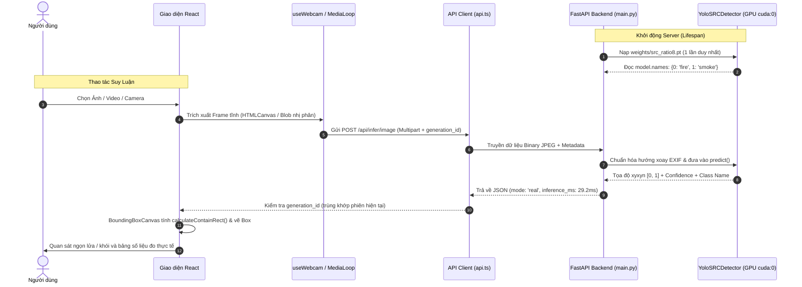

# CẤU TRÚC DỰ ÁN & TÀI LIỆU TỔNG HỢP ĐỒ ÁN CUỐI KỲ (CK)
## Hệ Thống Web Demo Phát Hiện Lửa & Khói Thời Gian Thực (Fire Detection Studio)

---

## 1. THÔNG TIN CHUNG VỀ ĐỒ ÁN

- **Tên đề tài**: Nghiên cứu và xây dựng Web Demo thử nghiệm mô hình phát hiện lửa & khói theo thời gian thực.
- **Mô hình AI cốt lõi**: **YOLO26n-P2** tích hợp module chú ý không gian **Spatial-Relational Co-Attention (SRC)** (hệ số co không gian `sr_ratio=8`).
- **Nền tảng công nghệ**:
  - **Backend (Inference Engine)**: Python 3.13, FastAPI, PyTorch (CUDA `cuda:0`), Ultralytics.
  - **Frontend (Interactive Studio)**: React 19, TypeScript strict mode, Vite, Canvas 2D Overlay.
- **Mục tiêu hệ thống**: Cung cấp công cụ trực quan độc lập, cho phép người dùng kiểm thử mô hình AI trên 3 nguồn dữ liệu: **Ảnh tĩnh**, **Video tệp tin** (hỗ trợ pause/tua/điều chỉnh tốc độ) và **Webcam trực tiếp**, hiển thị bounding box thời gian thực và độ trễ đo được.

---

## 2. SƠ ĐỒ CÂY THƯ MỤC TỔNG THỂ

```text
fire-detection-demo/
│
├── README.md                           # Hướng dẫn tổng quan, cài đặt và chạy toàn bộ dự án
├── PROJECT_STRUCTURE.md                 # [Tệp này] Tóm tắt cấu trúc chi tiết phục vụ báo cáo Đồ án Cuối kỳ
│
├── docs/                               # Tài liệu đặc tả kỹ thuật và tích hợp
│   ├── API_CONTRACT.md                 # Đặc tả hợp đồng API giao tiếp Frontend <-> Backend
│   └── MODEL_INTEGRATION.md            # Hướng dẫn chi tiết cách nạp checkpoint và module SRC
│
├── sample_images/                      # Ảnh mẫu trích xuất từ tập dữ liệu thực tế để demo nhanh
│   ├── sample_fire_smoke.jpg           # Ảnh mẫu có cả ngọn lửa và cột khói lớn (6 detections)
│   └── sample_neutral.jpg              # Ảnh mẫu an toàn, không có cháy khói (0 detections)
│
├── backend/                            # MÁY CHỦ SUY LUẬN AI (FASTAPI + PYTORCH)
│   ├── run.py                          # Script khởi chạy FastAPI server bằng Uvicorn (Port 8000)
│   ├── requirements.txt                # Danh sách thư viện Python cần thiết
│   ├── .env                            # Cấu hình biến môi trường cục bộ (đang trỏ src_ratio8.pt)
│   ├── .env.example                    # Tệp mẫu cấu hình môi trường
│   │
│   ├── app/                            # Mã nguồn ứng dụng FastAPI
│   │   ├── config.py                   # Quản lý cấu hình tập trung qua Pydantic Settings
│   │   ├── detector.py                 # DetectorAdapter, YoloSRCDetector (model thật), MockDetector
│   │   ├── main.py                     # Khởi tạo FastAPI, Lifespan nạp model 1 lần, các Endpoint API
│   │   └── schemas.py                  # Pydantic schemas định nghĩa dữ liệu Request / Response
│   │
│   ├── model_code/                     # Mã nguồn kiến trúc tùy biến (Spatial-Relational Co-Attention)
│   │   ├── README.md                   # Hướng dẫn cơ chế sys.path và import module kiến trúc
│   │   ├── src_coattention.py          # Wrapper re-export & tự động đăng ký module vào Ultralytics
│   │   ├── src_ratio8.pt               # Bản sao checkpoint mô hình dự phòng
│   │   └── src/                        # Gói Python chuẩn khớp với chuỗi pickle của checkpoint
│   │       ├── __init__.py
│   │       └── modules/
│   │           ├── __init__.py
│   │           └── attention/
│   │               ├── __init__.py
│   │               └── src.py          # Class SpatialRelationalCoAttention định nghĩa kiến trúc SRC
│   │
│   └── weights/                        # Thư mục chứa tệp trọng số huấn luyện chính thức
│       ├── README.md                   # Hướng dẫn đặt file trọng số và thông tin lớp
│       └── src_ratio8.pt               # Checkpoint huấn luyện thật (YOLO26n-P2 + SRC, 16.1 MB)
│
└── frontend/                           # GIAO DIỆN WEB NGƯỜI DÙNG (REACT + TYPESCRIPT + VITE)
    ├── package.json                    # Cấu hình package, scripts (dev, build, preview)
    ├── package-lock.json               # Khóa phiên bản dependency đảm bảo độ ổn định
    ├── tsconfig.json                   # Cấu hình TypeScript gốc
    ├── tsconfig.app.json               # Cấu hình TypeScript cho ứng dụng web (strict mode)
    ├── tsconfig.node.json              # Cấu hình TypeScript cho Vite build tools
    ├── vite.config.ts                  # Cấu hình máy chủ phát triển Vite
    ├── index.html                      # Trang HTML chính, nạp font hệ thống và thẻ meta
    ├── .env.example                    # Mẫu cấu hình URL API Backend (VITE_API_BASE_URL)
    ├── .oxlintrc.json                  # Cấu hình linter kiểm tra cú pháp code
    │
    ├── public/                         # Tài nguyên tĩnh phục vụ trình duyệt
    │   ├── favicon.svg                 # Biểu tượng ngọn lửa cho tab trình duyệt
    │   ├── icons.svg                   # Sprite icon vector
    │   └── samples/                    # Ảnh mẫu tĩnh để nạp trực tiếp vào giao diện
    │       ├── sample_fire_smoke.jpg   # Ảnh mẫu có lửa & khói
    │       └── sample_neutral.jpg      # Ảnh mẫu an toàn
    │
    └── src/                            # Mã nguồn ứng dụng React
        ├── main.tsx                    # Điểm nhập khởi chạy React Root DOM
        ├── App.tsx                     # Component điều phối chính (Core State Orchestrator)
        ├── App.css                     # Phong cách bổ trợ
        ├── index.css                   # Hệ thống Style Dark Theme Studio, biến màu, responsive
        │
        ├── components/                 # Các thành phần giao diện chuyên biệt
        │   ├── Header.tsx              # Thanh tiêu đề, báo trạng thái Backend, Model, nút Xem thử
        │   ├── SourceTabs.tsx          # 3 Tab chuyển đổi nguồn: Ảnh, Video, Camera
        │   ├── MediaViewer.tsx         # Khung trình chiếu media, xử lý letterbox contain & canvas
        │   ├── BoundingBoxCanvas.tsx   # Canvas 2D vẽ bounding box, crosshairs & nhãn pill tương phản
        │   ├── Toolbar.tsx             # Thanh công cụ điều khiển: Phát hiện, Đổi ảnh, Ngưỡng, Tua, Fullscreen
        │   ├── ResultPanel.tsx         # Bảng kết quả: số lượng vùng lửa/khói, latency ms, danh sách box
        │   ├── EmptyUploadArea.tsx     # Khung kéo thả tệp tải lên, nút chọn nhanh ảnh mẫu
        │   └── AdvancedSettingsModal.tsx # Hộp thoại thông số chi tiết mô hình (device, imgsz, class)
        │
        ├── hooks/                      # Custom React Hooks
        │   ├── useBackendStatus.ts     # Thăm dò kiểm tra sức khỏe backend (/health) và model (/status)
        │   └── useWebcam.ts            # Quản lý luồng webcam getUserMedia, chọn device, giải phóng camera
        │
        ├── services/                   # Tầng giao tiếp mạng
        │   └── api.ts                  # Client gọi REST API (infer/image, health, model/status)
        │
        ├── types/                      # Định nghĩa kiểu dữ liệu TypeScript
        │   └── index.ts                # DetectionItem, InferenceResponse, ModelStatus, SourceType...
        │
        └── utils/                      # Tiện ích tính toán toán học & media
            ├── coordinateUtils.ts      # Chuyển đổi tọa độ box [0, 1] sang pixel canvas khớp viền đen
            └── sampleMedia.ts          # Nạp ảnh mẫu thử nghiệm từ assets / canvas generator
```

---

## 3. BẢNG MÔ TẢ CHI TIẾT TỪNG MODULE & TỆP TIN QUAN TRỌNG

### 3.1. Phân hệ Backend (`backend/`)

| Tệp tin | Vai trò trong hệ thống | Chi tiết kỹ thuật phục vụ báo cáo |
|---|---|---|
| [`app/main.py`](file:///c:/fire_smoke_web/fire-detection-demo/backend/app/main.py) | **Cổng vào chính (API Entrypoint)** | Quản lý vòng đời (`lifespan`) để nạp mô hình một lần duy nhất lúc khởi động server, tránh cấp phát lại VRAM; triển khai các endpoint `/api/health`, `/api/model/status`, `/api/infer/image`; cấu hình CORS cho phép Frontend kết nối. |
| [`app/detector.py`](file:///c:/fire_smoke_web/fire-detection-demo/backend/app/detector.py) | **Lớp điều hợp suy luận (Detector Adapter)** | Cung cấp interface trừu tượng `DetectorAdapter` và 2 bộ nhận diện:<br>1. `YoloSRCDetector`: Nạp checkpoint PyTorch thật, sử dụng khóa luồng `threading.Lock()` đảm bảo an toàn truy cập đa luồng trên GPU, trích xuất tọa độ `xyxyn` chuẩn hóa `[0, 1]`, đo `inference_ms` chính xác.<br>2. `MockDetector`: Bộ giả lập cố định cho chế độ "Xem thử", dán nhãn `mock` rõ ràng, không làm sai lệch số liệu thực. |
| [`app/config.py`](file:///c:/fire_smoke_web/fire-detection-demo/backend/app/config.py) | **Cấu hình hệ thống (Settings)** | Sử dụng `pydantic_settings` đọc biến môi trường: `MODEL_PATH` (mặc định `weights/src_ratio8.pt`), `DEVICE` (tự động nhận diện GPU `cuda:0`), `IMGSZ` (640), `CONF_THRESHOLD` (0.25), giới hạn ảnh tải lên (20 MB). |
| [`app/schemas.py`](file:///c:/fire_smoke_web/fire-detection-demo/backend/app/schemas.py) | **Định nghĩa Schema (Data Contracts)** | Định nghĩa cấu trúc dữ liệu Pydantic: `DetectionItem` (class_id, class_name, confidence, box), `InferenceResponse`, `ModelStatusResponse`, `HealthResponse`. |
| [`model_code/src/modules/attention/src.py`](file:///c:/fire_smoke_web/fire-detection-demo/backend/model_code/src/modules/attention/src.py) | **Định nghĩa Module SRC** | **Điểm mấu chốt kỹ thuật**: Định nghĩa lớp `SpatialRelationalCoAttention` với cơ chế co không gian `sr_ratio=8` trên nhánh P2 để tiết kiệm VRAM, tính toán attention thông qua hàm `F.scaled_dot_product_attention`. Cấu trúc gói `src.modules.attention.src` khớp chính xác với pickle opcode trong checkpoint `src_ratio8.pt`. |
| [`model_code/src_coattention.py`](file:///c:/fire_smoke_web/fire-detection-demo/backend/model_code/src_coattention.py) | **Đăng ký module vào Ultralytics** | Tự động gán `SpatialRelationalCoAttention` vào namespace `ultralytics.nn.modules` và `ultralytics.nn.tasks` để parser của Ultralytics tự động khởi tạo đồ thị tầng 20 mà không cần sửa thư viện gốc. |
| [`weights/src_ratio8.pt`](file:///c:/fire_smoke_web/fire-detection-demo/backend/weights/src_ratio8.pt) | **Checkpoint huấn luyện thực tế** | Trọng số mạng nơ-ron YOLO26n-P2 + SRC (31 layers, 16.1 MB) huấn luyện trên tập dữ liệu cháy khói, nhận diện 2 lớp: `0: fire` và `1: smoke`. |
| [`run.py`](file:///c:/fire_smoke_web/fire-detection-demo/backend/run.py) | **Lệnh chạy Backend** | Khởi chạy Uvicorn server tại `http://0.0.0.0:8000` với 1 worker duy nhất tối ưu cho suy luận mô hình trên GPU cá nhân. |

---

### 3.2. Phân hệ Frontend (`frontend/`)

| Tệp tin / Component | Vai trò trong giao diện | Chi tiết kỹ thuật phục vụ báo cáo |
|---|---|---|
| [`src/App.tsx`](file:///c:/fire_smoke_web/fire-detection-demo/frontend/src/App.tsx) | **Điều phối trạng thái chính (Root)** | Quản lý toàn bộ vòng đời suy luận, kiểm soát biến `generation_id` đơn điệu tăng dần để hủy bỏ (abort) và bỏ qua các kết quả suy luận cũ khi người dùng tua video hoặc chuyển nguồn đột ngột; điều phối vòng lấy frame tĩnh từ video/camera (3–5 FPS). |
| [`src/components/BoundingBoxCanvas.tsx`](file:///c:/fire_smoke_web/fire-detection-demo/frontend/src/components/BoundingBoxCanvas.tsx) | **Hiển thị Bounding Box (Canvas 2D)** | Tính toán ma trận tỉ lệ và bù viền đen qua `calculateContainRect`, vẽ viền 2px sắc nét (Đỏ cho Lửa, Cyan cho Khói), 4 góc định vị crosshairs, vẽ nhãn pill nền đen tương phản cao (WCAG AA). Hỗ trợ lật trục X (`isMirrored`) khi dùng Webcam. |
| [`src/components/Header.tsx`](file:///c:/fire_smoke_web/fire-detection-demo/frontend/src/components/Header.tsx) | **Thanh trạng thái hệ thống** | Tách biệt độc lập 2 trạng thái: **Kết nối Backend** (Online/Offline) và **Mô hình AI** (`Model: Sẵn sàng (cuda:0)`). Cung cấp nút chuyển đổi chế độ `Xem thử` (mô phỏng) và nút mở bảng thông số nâng cao. |
| [`src/components/MediaViewer.tsx`](file:///c:/fire_smoke_web/fire-detection-demo/frontend/src/components/MediaViewer.tsx) | **Khung hiển thị Media trung tâm** | Chiếm 70% chiều ngang màn hình, áp dụng kỹ thuật letterbox `object-fit: contain` giúp hiển thị trọn vẹn cả ảnh ngang (16:9) lẫn ảnh dọc (9:16), gắn lớp phủ canvas bounding box đồng bộ 1:1 theo kích thước hiển thị. |
| [`src/components/Toolbar.tsx`](file:///c:/fire_smoke_web/fire-detection-demo/frontend/src/components/Toolbar.tsx) | **Thanh điều khiển tương tác** | Bố trí linh hoạt theo nguồn: nút `Phát hiện lửa`, đổi tệp, thanh trượt ngưỡng tin cậy (Confidence Slider: 5% - 95%), công tắc Bật/Tắt hiển thị Box, thanh tua video (Timeline scrubber), nút Bật/Tắt camera và chế độ toàn màn hình. |
| [`src/components/ResultPanel.tsx`](file:///c:/fire_smoke_web/fire-detection-demo/frontend/src/components/ResultPanel.tsx) | **Bảng kết quả & Đo lường** | Hiển thị thẻ tóm tắt số lượng vùng lửa & khói, thời gian suy luận thực tế từ server (`inference_ms`), FPS đo được, danh sách từng box kèm đốm màu (chỉ thị đỏ/cyan) và độ tin cậy phần trăm. Khi di chuột (hover) vào dòng sẽ làm nổi bật box tương ứng trên hình. |
| [`src/components/EmptyUploadArea.tsx`](file:///c:/fire_smoke_web/fire-detection-demo/frontend/src/components/EmptyUploadArea.tsx) | **Khu vực tải dữ liệu ban đầu** | Vùng kéo thả tệp hỗ trợ định dạng JPG, PNG, WebP (ảnh) và MP4, WebM (video); tích hợp 2 nút thử nhanh **Ảnh mẫu có lửa** và **Ảnh không có lửa** để trình diễn tức thì mà không cần tìm file. |
| [`src/components/AdvancedSettingsModal.tsx`](file:///c:/fire_smoke_web/fire-detection-demo/frontend/src/components/AdvancedSettingsModal.tsx) | **Bảng thông số chi tiết mô hình** | Hiển thị thẻ kỹ thuật: tên mô hình (`YOLO26n-P2-SRC`), thiết bị chạy (`cuda:0`), kích thước đầu vào (`640x640`), danh sách lớp (`0: fire, 1: smoke`) và thời gian hoạt động (uptime). |
| [`src/hooks/useWebcam.ts`](file:///c:/fire_smoke_web/fire-detection-demo/frontend/src/hooks/useWebcam.ts) | **Xử lý luồng Camera an toàn** | Quản lý `MediaStream`, tự động truy vấn danh sách thiết bị camera, chuyển đổi giữa camera trước/sau, bắt lỗi từ chối quyền (NotAllowedError) và giải phóng mọi MediaStreamTrack khi tắt camera hoặc đổi tab để tránh chiếm dụng thiết bị. |
| [`src/hooks/useBackendStatus.ts`](file:///c:/fire_smoke_web/fire-detection-demo/frontend/src/hooks/useBackendStatus.ts) | **Giám sát sức khỏe Backend** | Thăm dò chu kỳ (polling) kiểm tra `/api/health` và `/api/model/status`, tự động cập nhật cờ `isConnected` và thông tin mô hình lên thanh Header. |
| [`src/services/api.ts`](file:///c:/fire_smoke_web/fire-detection-demo/frontend/src/services/api.ts) | **Tầng mạng (Network Layer)** | Gửi tệp dạng `multipart/form-data` nhị phân (Binary Blob), truyền kèm metadata (`session_id`, `generation_id`, `frame_id`, `timestamp_ms`, `confidence_threshold`); hỗ trợ `AbortController` để ngắt request mạng kịp thời. |
| [`src/utils/coordinateUtils.ts`](file:///c:/fire_smoke_web/fire-detection-demo/frontend/src/utils/coordinateUtils.ts) | **Toán học tọa độ Bounding Box** | Hàm `calculateContainRect` tính toán chính xác phần ảnh thực sự nằm trong thẻ HTML có `object-fit: contain`, loại bỏ độ lệch do viền đen trên/dưới hoặc trái/phải, đảm bảo box luôn ôm khít ngọn lửa khi co giãn cửa sổ hoặc bật Fullscreen. |
| [`src/index.css`](file:///c:/fire_smoke_web/fire-detection-demo/frontend/src/index.css) | **Giao diện & Trải nghiệm (UI/UX)** | Bảng màu tối (Dark Slate Palette `#0b0f19`, `#111827`), điểm nhấn cam lửa `#f97316` và đỏ `#ef4444`, tương phản văn bản đạt chuẩn WCAG AA (tối thiểu 4.5:1), hỗ trợ `prefers-reduced-motion`, tương thích màn hình laptop 1366×768. |

---

## 4. SƠ ĐỒ LUỒNG DỮ LIỆU & ĐỒNG BỘ SUY LUẬN (DATA FLOW)



---

## 5. THÔNG SỐ KỸ THUẬT QUAN TRỌNG CẦN NHỚ KHI BẢO VỆ ĐỒ ÁN

Khi trình bày với Hội đồng hoặc Giảng viên hướng dẫn, hãy nắm chắc các thông số kỹ thuật thực nghiệm sau:

1. **Tổng số lớp mạng**: Mô hình hoàn chỉnh có **31 layers** (tăng 1 layer so với YOLO26n tiêu chuẩn do chèn thêm SRC).
2. **Vị trí tích hợp module SRC**: Nằm tại **Layer 20** trong đồ thị mạng, ngay sau khối `C3k2` của nhánh trích xuất đặc trưng vật thể siêu nhỏ **P2** (kích thước feature map $160 \times 160$).
3. **Cấu hình siêu tham số của module SRC**:
   - Số channels đầu vào (`c1`): $32$ channels (sau khi scale scale `n` của YOLO26).
   - Hệ số giảm chiều trung gian (`reduction`): $8 \implies \text{inter\_c} = \max(16, 32 // 8) = 16$ channels.
   - Tỷ lệ giảm không gian (`sr_ratio`): $8$ (áp dụng qua Convolution $8 \times 8$, stride $8$ trên Key và Value để tiết kiệm VRAM và tăng tốc độ tính ma trận Attention).
   - Hàm Attention: Sử dụng PyTorch scaled dot-product attention ($O(N)$ bộ nhớ khi có GPU hỗ trợ).
4. **Tập nhãn nhận diện (`model.names`)**:
   - `0`: **`fire`** (Lửa) — Viền đỏ, nhãn đỏ cam.
   - `1`: **`smoke`** (Khói) — Viền cyan (xanh ngọc), nhãn cyan.
5. **Hiệu năng suy luận thực tế đo trên máy trạm**:
   - **Thiết bị**: `NVIDIA GeForce RTX 4060 Laptop GPU` (`cuda:0`).
   - **Thời gian suy luận (Inference Latency)**: **~29.16 ms – 35 ms** ở trạng thái ấm (warm run).
   - **Tốc độ khung hình (Frame Rate)**: Đạt từ **28 – 34 FPS**, đáp ứng hoàn toàn yêu cầu thời gian thực.
   - **Độ phân giải chuẩn hóa đầu vào**: $640 \times 640$ pixels (`IMGSZ=640`).

---

## 6. HƯỚNG DẪN KHỞI CHẠY NHANH ĐỂ TRÌNH CHIẾU DEMO

Trong buổi báo cáo, hãy mở 2 cửa sổ terminal (PowerShell) để khởi chạy:

### Bước 1: Khởi động Backend (FastAPI)
```powershell
# Chuyển vào thư mục backend
cd C:\fire_smoke_web\fire-detection-demo\backend

# Khởi chạy server
python run.py
```
> **Dấu hiệu thành công**: Terminal hiển thị dòng:  
> `[INFO] fire_detector: Nạp mô hình thành công! Danh sách lớp: {0: 'fire', 1: 'smoke'}`  
> `[INFO] fire_studio_api: Detector khởi tạo xong. Trạng thái mô hình thật: SẴN SÀNG`

### Bước 2: Khởi động Frontend (React Studio)
```powershell
# Mở một terminal mới, chuyển vào thư mục frontend
cd C:\fire_smoke_web\fire-detection-demo\frontend

# Khởi chạy preview server đã build sẵn
npm run preview -- --port 5173
```

### Bước 3: Trình chiếu trên Trình duyệt
- Truy cập địa chỉ: **`http://localhost:5173`**
- Nhìn góc trên bên phải thanh Header:
  - Chấm xanh lá **`Backend: Kết nối`**
  - Khung viền xanh lá **`Model: Sẵn sàng (cuda:0)`**
- Bấm vào nút **`Ảnh mẫu có lửa`** $\rightarrow$ bấm **`Phát hiện lửa`** để biểu diễn kết quả suy luận thực tế với 6 bounding box phân biệt rõ Lửa (đỏ) và Khói (cyan).
- Bấm sang tab **`Video`** hoặc **`Camera (Webcam)`** để biểu diễn khả năng nhận diện thời gian thực.

